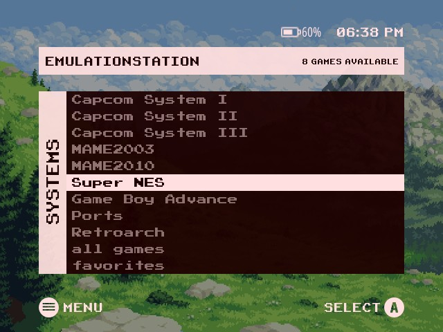
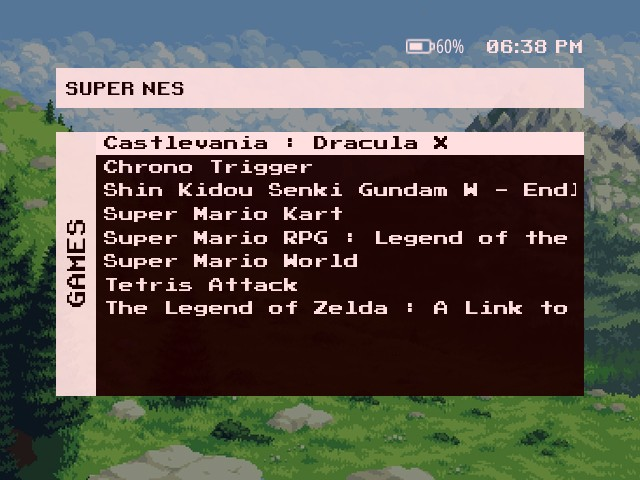
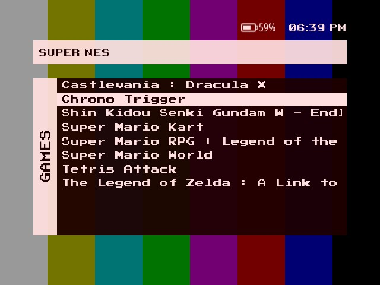
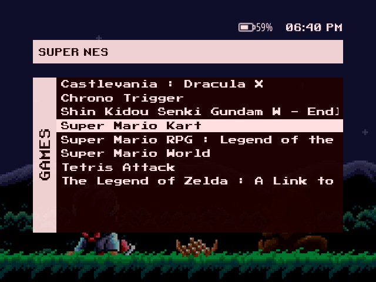

# es-theme-misterfpga-facamod

**EN** · [BR](README.pt-BR.md)

 [](LICENSE) [](https://www.reddit.com/user/jovemlcxx/) [](https://ko-fi.com/jovemlcxx)

Port of **MiSTer Menu** (ES-DE, by Anthony Caccese) to **EmulationStation-fcamod** on the **R36S** and clones (ArkOS family, 640×480): the simple MiSTer menu, a pink header, a side column with the rotated name of the screen and a dark red list over a wallpaper.

<p align="center">
   <br>
   
</p>

[Install](#install) · [The theme](#the-theme) · [Options](#options) · [Wallpapers](#wallpapers) · [Compatibility](#compatibility) · [Customize](#customize) · [Credits](#credits)

## Install

1. Download this repository (**Code → Download ZIP**) or clone it.
2. Copy the folder to the themes folder of your device: `/roms/themes/` (the `themes` folder of the games partition) or `~/.emulationstation/themes/`. It must be named `es-theme-misterfpga-facamod` (or `es-theme-misterfpga-facamod-main` from the ZIP). When updating, delete the old folder first.
3. **START → UI Settings → Theme Set → es-theme-misterfpga-facamod**. The options are in **UI Settings → Theme Configuration**.

Leave the frontend's **Gamelist View Style** on **automatic**: other values replace the theme's game list layout.

## The theme

- **System screen:** the list of systems, the selected one on a pink bar, the number of games in the header.
- **Game list:** the same window with the games, the system name in the header.
- **Button legend** (on by default, can be turned off): menu and confirm button at the bottom, in Nintendo/Xbox (A B X Y) or PlayStation style. Battery, clock and legend follow the edges of the central window.
- **Wallpapers:** 20 slots, with optional animated video; 1 to 3 are the original's.
- Dark and light settings menus, the navigation sounds of the original.
- **26 languages**: every option and the name of the screen follow the frontend language.

## Options

| Option | Choices (default first) | Notes |
|---|---|---|
| Aspect Ratio | 4:3 | 640×480 screens (R36S, RG351MP...). |
| Wallpaper | 1 to 20 | 1 Crisp Mountain Air, 2 Test Pattern, 3 Pocky & Rocky; see [Wallpapers](#wallpapers). |
| Color Scheme | Dark / Light | Settings menu and on-screen keyboard. |
| Background Video | Enabled / Disabled | Disable it on slow devices; the wallpaper image is used instead. |
| Button Icons | Nintendo / Xbox, PlayStation | PlayStation follows the button position: A = ○, B = ✕. |
| Confirm Button (A/B) | A / B | Use **B** if you swapped A/B in the system (dArkOSen ships swapped). |
| Button Legend | Enabled / Disabled | The menu / confirm legend at the bottom. |

## Wallpapers

Each of the 20 slots is an **image** (`bg_<n>.png`) and, optionally, an **animated video** (`bg_<n>.mp4`) that plays on top of it. The image is also the fallback while the video loads or when the video is disabled. It is shown at 60 % brightness, as in the original.

1. Make it **640×480**: the theme stretches it to the whole screen.
2. Video (optional): 640×480 `.mp4`, short (10 to 30 s, it loops), no sound, 30 fps, under ~20 MB.
3. Name both files with a free slot number from 4 to 20 (e.g. `bg_4.png` and `bg_4.mp4`), copy them to `_inc/background/` and pick the number in **Theme Configuration → Wallpaper**.

```
ffmpeg -i input.mp4 -vf "scale=640:480:force_original_aspect_ratio=increase,crop=640:480" -an -r 30 -c:v libx264 -crf 23 -movflags +faststart bg_4.mp4
ffmpeg -i bg_4.mp4 -frames:v 1 bg_4.png
```

Keep a copy of your `bg_*` files before updating the theme.

## Compatibility

What has actually been tested, and how:

| | Theme |
|---|---|
| dArkOS4Clone | ✅ |
| ArkOS, arkos4clone, dArkOS, dArkOSRE-R36, dArkOSen | 🧪 |
| Batocera, Knulli, EmuELEC, ArchR, muOS | not tested |

- ✅ **Validated on real hardware** (R36S): system screen, game list, battery and 12 h clock, button legend.
- 🧪 **Waiting for feedback:** same frontend family and same theme elements as the Xbox, PS5 and XMB themes, which are checked against each system's EmulationStation.

The theme draws text only (no system logos), so every platform works. Known limits of fcamod that a theme cannot change: a game name wider than the list is cut, and collections (all games, favorites, last played) are shown in lower case.

**Help test your system:** tell me your system, its version and what looks wrong, by [opening an issue](https://github.com/jovemlcxx/es-theme-misterfpga-facamod/issues) or [on Reddit](https://www.reddit.com/user/jovemlcxx/) (u/jovemlcxx).

## Customize

| What | Where |
|---|---|
| Wallpapers | `_inc/background/bg_<n>.png` · `.mp4` (640×480) |
| Colors (menus) | `_inc/colors/dark.xml`, `light.xml` |
| Translations | `_inc/lang/<code>.xml` |
| Layout | `aspect-ratio-4-3.xml` (written in pixels of 640×480) |

## Credits and license

**Design:** [MiSTer Menu](https://github.com/anthonycaccese/mister-menu-es-de) by Anthony Caccese (CC BY-NC-SA), itself made after the menu of the MiSTer FPGA project. Not affiliated with the MiSTer project. Wallpaper 1, "Crisp Mountain Air", by [skeddles](https://lospec.com/skeddles); wallpaper 2 is a test pattern and 3 is a *Pocky & Rocky* screenshot (© its owners). Fonts (Retro Gaming, Press Start 2P) and sounds are the original's and keep their own licenses.

**License:** [CC BY-NC-SA 4.0](LICENSE), the same as the original. Free: selling it, alone or bundled with devices, SD cards or images, is not allowed.

**Support:** if this theme is useful to you, you can support my work on [Ko-fi](https://ko-fi.com/jovemlcxx). Thank you! ☕

[](https://ko-fi.com/jovemlcxx)
