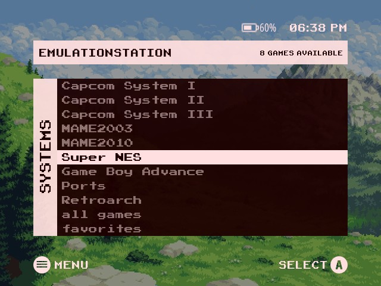
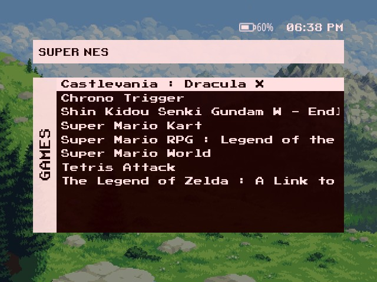
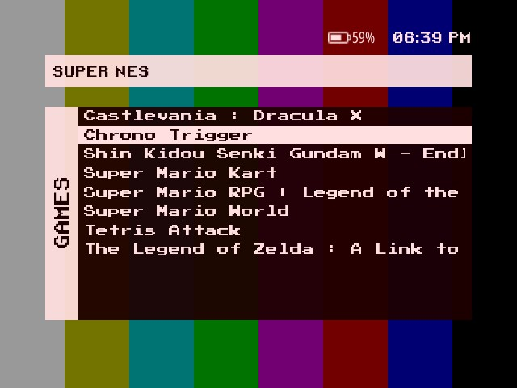
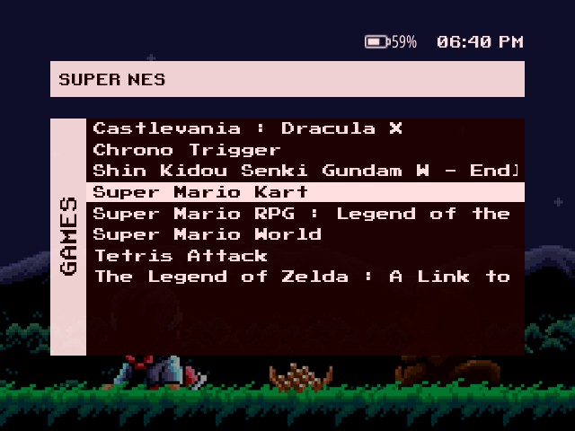

# es-theme-misterfpga-fcamod

[EN](README.md) · **BR**

 [](LICENSE) [](https://www.reddit.com/user/jovemlcxx/) [](https://ko-fi.com/jovemlcxx)

Port do **MiSTer Menu** (ES-DE, de Anthony Caccese) para o **EmulationStation-fcamod** no **R36S** e clones (família ArkOS, 640×480): o menu simples do MiSTer, com cabeçalho rosa, coluna lateral com o nome da tela girado e uma lista vermelho-escura sobre um papel de parede.

<p align="center">
   <br>
   
</p>

[Instalação](#instalação) · [O tema](#o-tema) · [Opções](#opções) · [Papéis de parede](#papéis-de-parede) · [Compatibilidade](#compatibilidade) · [Personalizar](#personalizar) · [Créditos e licença](#créditos-e-licença)

## Instalação

1. Baixe este repositório (**Code → Download ZIP**) ou clone-o.
2. Copie a pasta para a pasta de temas do aparelho: `/roms/themes/` (a pasta `themes` da partição de jogos) ou `~/.emulationstation/themes/`. Ela deve se chamar `es-theme-misterfpga-fcamod` (ou `es-theme-misterfpga-fcamod-main`, vinda do ZIP). Ao atualizar, apague a pasta antiga antes.
3. **START → CONFIGURAR INTERFACE → TEMA → es-theme-misterfpga-fcamod**. As opções ficam em **CONFIGURAR INTERFACE → CONFIGURAÇÕES DE TEMA**.

Deixe o **MODO DE VISUALIZAÇÃO, LISTA DE JOGO** do frontend em **automático**: outros valores substituem o layout da lista de jogos do tema.

## O tema

- **Tela de sistemas:** a lista de sistemas, o selecionado numa barra rosa, e o número de jogos no cabeçalho.
- **Lista de jogos:** a mesma janela com os jogos e o nome do sistema no cabeçalho.
- **Legenda dos botões** (ativada por padrão, dá para desativar): menu e botão de confirmar no rodapé, no estilo Nintendo/Xbox (A B X Y) ou PlayStation. Bateria, relógio e legenda seguem as bordas da janela central.
- **Papéis de parede:** 20 espaços, com vídeo animado opcional; de 1 a 3 são os do original.
- Menus de configuração escuro e claro, os sons de navegação do original.
- **26 idiomas**: todas as opções e o nome da tela seguem o idioma do frontend.

## Opções

| Opção | Escolhas (padrão primeiro) | Observações |
|---|---|---|
| Proporção de Tela | 4:3 | Telas 640×480 (R36S, RG351MP...). |
| Papel de Parede | 1 a 20 | 1 Crisp Mountain Air, 2 Test Pattern, 3 Pocky & Rocky; veja [Papéis de parede](#papéis-de-parede). |
| Esquema de Cores | Escuro / Claro | Menu de configurações e teclado na tela. |
| Vídeo de Fundo | Ativado / Desativado | Desative em aparelhos lentos; a imagem do papel de parede é usada no lugar. |
| Ícones dos Botões | Nintendo / Xbox, PlayStation | O PlayStation segue a posição dos botões: A = ○, B = ✕. |
| Botão de Confirmar (A/B) | A / B | Use **B** se você inverteu A/B no sistema (o dArkOSen já vem invertido). |
| Legenda dos Botões | Ativado / Desativado | A legenda de menu / confirmar no rodapé. |

## Papéis de parede

Cada um dos 20 espaços é uma **imagem** (`bg_<n>.png`) e, opcionalmente, um **vídeo animado** (`bg_<n>.mp4`) que toca por cima dela. A imagem também aparece enquanto o vídeo carrega ou quando o vídeo está desativado. Ela é mostrada a 60 % do brilho, como no original.

1. Faça em **640×480**: o tema estica o papel de parede para a tela inteira.
2. Vídeo (opcional): `.mp4` 640×480, curto (10 a 30 s, ele repete), sem som, 30 fps, abaixo de ~20 MB.
3. Dê aos dois arquivos o número de um espaço livre de 4 a 20 (por exemplo `bg_4.png` e `bg_4.mp4`), copie para `_inc/background/` e escolha o número em **CONFIGURAÇÕES DE TEMA → Papel de Parede**.

```
ffmpeg -i entrada.mp4 -vf "scale=640:480:force_original_aspect_ratio=increase,crop=640:480" -an -r 30 -c:v libx264 -crf 23 -movflags +faststart bg_4.mp4
ffmpeg -i bg_4.mp4 -frames:v 1 bg_4.png
```

Guarde uma cópia dos seus arquivos `bg_*` antes de atualizar o tema.

## Compatibilidade

O que foi realmente testado, e como:

| | Tema |
|---|---|
| dArkOS4Clone | ✅ |
| ArkOS, arkos4clone, dArkOS, dArkOSRE-R36, dArkOSen | 🧪 |
| Batocera, Knulli, EmuELEC, ArchR, muOS | não testado |

- ✅ **Validado no aparelho** (R36S): tela de sistemas, lista de jogos, bateria e relógio de 12 h, legenda dos botões.
- 🧪 **Aguardando retorno:** mesma família de frontend e mesmos elementos de tema do Xbox, PS5 e XMB, que são conferidos contra o EmulationStation de cada sistema.

O tema desenha só texto (sem logos de sistemas), então toda plataforma funciona. Limites do fcamod que um tema não consegue mudar: nome de jogo mais largo que a lista é cortado, e as coleções (todos os jogos, favoritos, últimos jogados) aparecem em minúsculas.

**Ajude a testar o seu sistema:** me conte qual é o sistema, a versão e o que parece errado, [abrindo uma issue](https://github.com/jovemlcxx/es-theme-misterfpga-fcamod/issues) ou [pelo Reddit](https://www.reddit.com/user/jovemlcxx/) (u/jovemlcxx).

## Personalizar

| O quê | Onde |
|---|---|
| Papéis de parede | `_inc/background/bg_<n>.png` · `.mp4` (640×480) |
| Cores (menus) | `_inc/colors/dark.xml`, `light.xml` |
| Traduções | `_inc/lang/<código>.xml` |
| Layout | `aspect-ratio-4-3.xml` (escrito em pixels de 640×480) |

## Créditos e licença

**Design:** [MiSTer Menu](https://github.com/anthonycaccese/mister-menu-es-de), de Anthony Caccese (CC BY-NC-SA), feito a partir do menu do projeto MiSTer FPGA. Sem afiliação com o projeto MiSTer. Papel de parede 1, "Crisp Mountain Air", de [skeddles](https://lospec.com/skeddles); o 2 é uma carta de ajuste e o 3 é uma captura de *Pocky & Rocky* (© dos donos). As fontes (Retro Gaming, Press Start 2P) e os sons são os do original e mantêm as licenças deles.

**Licença:** [CC BY-NC-SA 4.0](LICENSE), a mesma do original. Gratuito: é proibido vendê-lo, sozinho ou junto com aparelhos, cartões SD ou imagens.

**Apoio:** se este tema for útil para você, pode apoiar meu trabalho no [Ko-fi](https://ko-fi.com/jovemlcxx). Obrigado! ☕

[](https://ko-fi.com/jovemlcxx)
